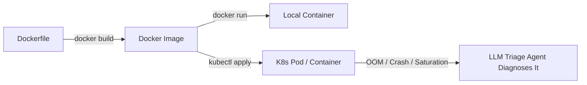

# Docker Essentials for Cloud Incident Triage Agent

This reference contains strictly the **concepts**, **commands**, and **mechanisms** you need from Docker to build and troubleshoot this project. You do not need to master Docker completely—focus only on what directly connects to Kubernetes, your microservices demo app, and the LLM agent.

---

## 1. Core Vocabulary (Plain-English & Project Context)

| Term | What It Is | How It Matters in This Project |
|---|---|---|
| **Image** | A frozen read-only template (code, dependencies, OS packages). | Every microservice (e.g. `frontend`, `cartservice`, `payment`) is packaged into an image. |
| **Container** | A running, isolated instance of an image. | The process running your service inside the cluster. |
| **Dockerfile** | Plain-text recipe used to build an image. | If you need to build custom services, fix mock services, or add faults. |
| **Registry / Docker Hub** | A library/store of images (e.g. `docker.io`, `ghcr.io`). | Where k3s or Docker pulls images like Prometheus, Grafana, and the boutique services. |
| **Volume / Mount** | Directory shared between host and container. | Used for persistent data (like Prometheus metric history or Loki logs). |
| **Port Mapping (`-p`)** | Forwarding a host port to a container port (`8080:80`). | Accessing Grafana or the demo store frontend from your local browser (`localhost`). |
| **Environment Variable (`-e`)** | Configuration values injected at startup. | How services configure DB connections, ports, or where you inject config-based faults. |
| **Entrypoint / CMD** | Default command executed when container boots. | Misconfiguring this intentionally simulates crash loops (`CrashLoopBackOff`). |

---

## 2. Docker vs. Kubernetes: Why Learn Docker First?

Kubernetes does **not** replace containers; it orchestrates them:

- When the triage agent queries Kubernetes, it inspects container states, container logs, and container resource limits.
- If you understand what a container is, Kubernetes pod errors (`CrashLoopBackOff`, `OOMKilled`) make immediate sense.

---

## 3. The Essential Docker Commands Cheat Sheet

### A. Lifecycle & Inspection

| Command | Purpose | When You Use It in This Project |
|---|---|---|
| `docker run -d -p 8080:80 --name test-web nginx` | Run a container in detached (`-d`) background mode with port forwarding. | Testing quick mock services or baselines. |
| `docker ps` | List all running containers. | Checking if the local daemon, local registries, or tooling are alive. |
| `docker ps -a` | List all containers (including exited/crashed ones). | Checking exit codes (`Exited (137)` = OOM killed). |
| `docker logs <container_name_or_id>` | Stream or print container stdout/stderr. | Exactly what Loki does automatically in the full stack. |
| `docker logs --tail 50 <container_name>` | Print only the last 50 lines. | Understanding how the agent must cap log outputs to prevent prompt overflow. |
| `docker inspect <container_name>` | Show full JSON configuration, network, and health status. | Verifying environment variables, labels, and limits. |
| `docker stop <container_name>` | Gracefully stop a running container. | Simulating service downtime manually. |
| `docker rm -f <container_name>` | Force delete a container. | Cleaning up test runs. |

### B. Building & Packaging

| Command | Purpose | When You Use It |
|---|---|---|
| `docker build -t my-service:v1 .` | Build an image from a `Dockerfile` in the current folder. | Packaging your agent service or custom injector code. |
| `docker images` | List local cached images. | Verifying an image exists before deploying it. |
| `docker rmi <image_id>` | Remove an image from local cache. | Freeing disk space. |

### C. Debugging & Interacting (Crucial for SRE)

| Command | Purpose | When You Use It |
|---|---|---|
| `docker exec -it <container_name> sh` | Open an interactive terminal inside a running container. | Verifying DNS, inspecting configuration files, checking network connectivity. |
| `docker top <container_name>` | View running processes inside container. | Checking if a stress tool or memory leak process is running. |
| `docker stats` | Live stream of CPU, memory usage, limits, and network I/O. | Manually observing the exact metrics that Prometheus scrapes. |

---

## 4. Concepts Specifically Tied to Injected Faults

Your project introduces intentional failures. Here is how Docker-level mechanics trigger the exact faults you will evaluate:

### 1. Out of Memory (OOMKilled)
- **Mechanism:** A container is assigned a hard memory ceiling (e.g., `--memory="128m"` in Docker or `resources.limits.memory` in K8s).
- **Behavior:** When the process inside requests more than 128MB, the Linux kernel OOM-killer immediately kills the process with **Exit Code 137**.
- **Agent Clue:** Logs end abruptly; container restart count increases; state says `OOMKilled`.

### 2. CPU Saturation
- **Mechanism:** Container is assigned a CPU quota (e.g., `--cpus="0.2"`).
- **Behavior:** The container process is throttled by CFS (Completely Fair Scheduler). Response latency spikes; timeouts occur.
- **Agent Clue:** Prometheus metrics show `container_cpu_usage_seconds_total` at or near the limit; error rate spikes due to upstream request timeouts.

### 3. Crash Loop (`CrashLoopBackOff`)
- **Mechanism:** The entrypoint process fails on startup (e.g. bad command line argument, missing required environment variable, or missing configuration file).
- **Behavior:** Process terminates with non-zero exit code (e.g. `Exit Code 1`). Orchestrator keeps trying to restart it.
- **Agent Clue:** `docker logs` contains stack trace / panic message on line 1–5; status shows constant restarts.

### 4. Broken Network / Downstream Dependency Down
- **Mechanism:** Dependent container stopped or unreachable.
- **Behavior:** Calling service logs `Connection refused`, `502 Bad Gateway`, or `i/o timeout`.
- **Agent Clue:** One service fails, but logs reveal the error originates from connection attempts to another service IP/hostname.

---

## 5. Practical Checklist: "Am I Ready for Kubernetes?"

You have mastered enough Docker for this project once you can answer **YES** to these 4 checkpoints:

- [ ] Can you run `docker run -d -p 8080:80 nginx` and open `http://localhost:8080` in your browser?
- [ ] Can you use `docker logs` and `docker exec -it` to view logs and explore a running container's shell?
- [ ] Do you know what **Exit Code 137** means when a container dies?
- [ ] Can you write a 4-line `Dockerfile` (`FROM`, `WORKDIR`, `COPY`, `CMD`) to containerize a Python script?
