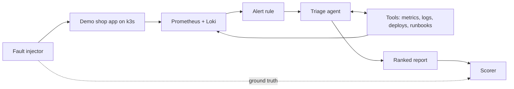

# Cloud Incident Triage Agent: Build Guide (6 weeks, student team)

Every number in this guide (RAM use, timings, free-tier limits, model quality) is an **unverified claim** until you measure it on your own machines. Verify tool names and versions against their current docs before starting.

---

## 1. What you are building

A system that:

1. Runs a demo microservices app on a local Kubernetes cluster.
2. Collects its logs and metrics.
3. Breaks the app on purpose in known ways (fault injection).
4. Receives the resulting alert and has an LLM agent investigate using read-only tools.
5. Produces a ranked list of root-cause hypotheses with evidence.
6. Scores that output against the known fault.

**Research question (write it on page 1 of your report):**
How accurately and how quickly can a tool-using LLM agent identify the root cause of injected faults in a microservices system, compared with a rule-based script, a tool-less LLM, and a human using dashboards?

If your team cannot agree on this sentence, stop and fix that first.

### Architecture



### Glossary (minimum vocabulary)

| Term | Meaning |
|---|---|
| Microservices | One app split into small services (cart, payment, catalog) that call each other |
| Incident | Something breaks in production |
| Triage | First diagnosis step: what is wrong, where, how urgent |
| Root cause | The real reason, not the symptom |
| Metrics | Numbers over time (CPU, memory, error rate, latency) |
| Logs | Text lines services write |
| Runbook | Team document: "if you see X, check Y" |
| Fault injection | Breaking the system deliberately and recording what you broke |
| Agent | An LLM that picks tools, reads results, and repeats until it can answer |
| IaC | Infrastructure described in code so one command rebuilds it |

---

## 2. Week 0: learning crash course (4 to 5 days, before the build)

Do not try to master anything. Learn only what the build needs. Split topics across teammates, then each person teaches the others for 30 minutes.

| Topic | What to learn | Time | Done when you can |
|---|---|---|---|
| Docker | images, containers, volumes, compose | 1 day | Build and run a small service in a container |
| Kubernetes basics | pod, deployment, service, namespace, configmap, `kubectl get/describe/logs/events`, resource limits | 1.5 days | Deploy an app, break it, read why it broke |
| Prometheus + Loki | scraping, basic PromQL (`rate`, `sum by`), LogQL line filters, Grafana panels | 1 day | Plot an error rate and find an error log line |
| LLM tool calling | function/tool calling in your chosen API or Ollama, structured JSON output | 1 day | A script where the LLM calls a Python function and uses the result |
| Git teamwork | branches, pull requests, rebasing, resolving conflicts | 0.5 day | Open a PR and review a teammate's PR |

Sources: official documentation for Docker, Kubernetes (including its interactive tutorials), Prometheus ("getting started"), Grafana Loki, and your LLM provider's tool-calling guide. Verify each is current before relying on it.

**Rule:** learning that does not end in a working mini-demo does not count.

---

## 3. Team structure and synchronization

Assumption: 3 people. With 4, add a fourth person on demo, docs and the human baseline.

| Role | Owns | Does not touch |
|---|---|---|
| A: Infra | cluster, demo app, observability stack, alert rules, IaC, CI | prompts, scoring logic |
| B: Agent | tools, agent loop, runbook retrieval, prompts, report schema | cluster internals |
| C: Evaluation | fault injector, fault manifest, scorer, baselines, human study, report data | agent internals |

Everyone reviews at least one other role's pull requests. That is how knowledge spreads and how you survive an oral defense where any member may be asked about any part.

### The key to not blocking each other: contracts first

The main failure of student teams is that B waits for A's infrastructure. Prevent it by agreeing on interfaces in **week 1** and developing against recorded data.

1. **Tool schemas** (B defines, A and C review). Example:

```json
{
  "name": "query_metrics",
  "description": "Return a metric time series for one service.",
  "parameters": {
    "service": "string",
    "metric": "cpu | memory | error_rate | latency_p95 | restarts",
    "minutes_back": "integer, max 60"
  }
}
```

2. **Fault manifest** (C defines, A and B review). One YAML entry per fault:

```yaml
- id: F-014
  type: bad_config
  service: payment
  description: DB connection pool lowered from 20 to 2
  injected_by: scripts/faults/bad_config_pool.sh
  expected_root_cause: "payment: connection pool too small after config change"
  split: test        # dev or test
  difficulty: medium
```

3. **Alert payload format** (A defines). Agree on fields: alert name, service, severity, start time.
4. **Report schema** (B defines): ranked list of `{cause, service, confidence, evidence[]}`, where each evidence item references a tool call id.

5. **Recorded fixtures.** As soon as A has any working metrics and logs, save real responses as JSON files. B builds and tests the agent against these fixtures with no cluster running. This unblocks B in week 2.

### Repository layout (monorepo)

```
triage-agent/
  infra/            # Terraform or Helm, k3s setup, observability config
  app/              # demo app manifests (pinned version, not modified)
  agent/            # loop, tools, prompts, retrieval
  faults/           # injection scripts + manifest.yaml
  eval/             # scorer, baselines, result CSVs
  runbooks/         # markdown runbooks used by retrieval
  fixtures/         # recorded tool responses for offline development
  docs/             # report drafts, decision log
  Makefile          # make up | make down | make fault ID=F-014 | make eval
  .github/workflows/
```

### Git rules

- `main` is protected. No direct pushes.
- One short-lived branch per task: `infra/loki-setup`, `agent/tool-metrics`, `eval/scorer`.
- A pull request needs one review from a different role and a passing CI run.
- PRs stay under about 300 changed lines. Large PRs do not get reviewed, they get approved blindly.
- Commit prompts and fault manifests like code. A prompt change without a commit is an unreproducible result.

### Rhythm

| When | What | Length |
|---|---|---|
| Daily | async status in chat: done, doing, blocked | 3 lines each |
| Twice a week | sync call: demo what works, resolve blockers | 30 min |
| End of every week | integration check: does the whole chain run on a clean checkout? | 1 hour |
| Decision log | `docs/decisions.md`: date, decision, reason, alternative rejected | ongoing |

The decision log is your best material for the professor's "why did you do it this way" question and for CV interviews.

---

## 4. Test environments

Free means local. A shared free cloud cluster is unreliable. Each member runs their own copy, made identical by code.

| Environment | Purpose | Cost |
|---|---|---|
| Fixtures (no cluster) | Develop and unit-test agent tools and loop | Lightest |
| Local k3s or kind with the demo app | Integration tests and fault injection | Heavy on RAM |
| Hosted LLM API for evaluation runs | Reliable reasoning, consistent runs | Free tier limits apply, check them |
| Local small model via Ollama | Comparison result, offline development | Free, slow, 4 GB VRAM limit |

Notes for your hardware class (24 GB RAM, 4 GB VRAM):

- The GPU is for inference only. Do not plan to train or fine-tune anything.
- RAM is the real limit. Cluster + demo app + observability stack + model offload may not fit together. Measure in week 1 with the whole stack running.
- If the full demo app is too heavy, remove non-essential services (recommendation, ads, load generator) before considering a smaller app. Writing your own app costs weeks.
- `make up` must create the whole environment from scratch. If a teammate needs a 20-step wiki to run it, it is broken.

---

## 5. Build steps in detail

### Step 1: Environment (A, week 1)

1. Install k3s or kind.
2. Deploy the chosen open-source microservices demo, pinned to a specific version.
3. Install Prometheus, Loki, Grafana (Helm charts are the fastest route).
4. Confirm you can see per-service CPU, memory, error rate, and logs in Grafana.
5. Write `make up` and `make down`.

Done when: a teammate clones the repo and gets a working dashboard with one command.

### Step 2: Evaluation plan (C, week 1)

Write before any agent code:

- 8 fault types, about 5 variants each, 40 total.
- Dev/test split: 20 faults for tuning, 20 held out and never touched until week 5.
- Metrics: top-1, top-3, time to diagnosis, cost per investigation, evidence validity.
- Baselines (see section 7).

Fault types to cover (verify each is practical on your cluster):

| Type | One way to inject |
|---|---|
| Bad config | patch a ConfigMap or env var (pool size, timeout, wrong URL) |
| Memory leak / OOM | lower the memory limit or run a leaking variant |
| CPU saturation | stress process in a pod, or tight CPU limit |
| Dependency down | scale a downstream deployment to zero |
| Dependency slow | add latency with a network tool or proxy |
| Crash loop | deploy a bad image tag or break a startup variable |
| Bad deploy | roll out a version with a faulty setting |
| Network delay between services | traffic-control rules in a pod |

Start with simple `kubectl` scripts. Add a chaos tool only if scripts become the bottleneck.

### Step 3: Tools without the LLM (B and A, week 2)

Build four read-only tools and test them as plain functions:

| Tool | Source | Risk |
|---|---|---|
| `query_metrics` | Prometheus HTTP API | returning too much data, which floods the model |
| `search_logs` | Loki HTTP API | huge or noisy output |
| `get_recent_deploys` | Kubernetes events + a changelog file your injector and CI write | deploy history is invented for a demo, say so honestly |
| `search_runbooks` | embeddings over `runbooks/*.md` (CPU embedding model, small vector store) | runbooks that give away the answers to your own faults |

Rules for every tool:

- Return **summaries with caps** (top N log lines, downsampled series), not raw dumps.
- Return structured JSON with a stable id per call so the report can cite it.
- Never mutate anything. The agent is read-only. This is a design decision you defend.

### Step 4: Agent loop (B, weeks 2 to 3)

Write the loop yourself. A framework adds opacity you cannot defend in a defense. Skeleton:

```python
def investigate(alert, max_steps=8):
    messages = [system_prompt, alert_to_text(alert)]
    evidence = {}
    for step in range(max_steps):
        reply = llm(messages, tools=TOOL_SCHEMAS)
        if reply.tool_calls:
            for call in reply.tool_calls:
                result = run_tool(call)          # capped, structured
                evidence[call.id] = result
                messages.append(tool_result(call.id, result))
        else:
            report = parse_report(reply.text)    # strict JSON schema
            return validate_citations(report, evidence)
    return forced_final_report(messages)         # step budget exhausted
```

Non-negotiables:

- Step limit and timeout.
- Strict output schema, with retry on invalid JSON.
- Every evidence item in the report must reference a real tool call id. Reject reports that cite evidence the tools never returned. This is your hallucination control.
- Log every run completely (prompt, tool calls, outputs, final report, tokens, seconds) to files. Evaluation depends on these logs.

### Step 5: Runbook retrieval (B, week 3)

Keep it small: 10 to 15 short markdown runbooks, chunked, embedded, searched by similarity. Do not put fault IDs or exact fault descriptions into runbooks. Write them as general operational guidance, or you are testing whether the agent can find its own answer key.

### Step 6: Alerting glue (A, week 3)

Alertmanager (or equivalent) sends a webhook to the agent service. Test with one fault end to end: fault injected, alert fires, agent runs, report saved.

### Step 7: CI/CD and IaC (A, ongoing)

- CI on every PR: lint, unit tests on tools using fixtures, schema validation of the fault manifest.
- CD: deploying the agent service on push to `main`.
- IaC: Helm values and Terraform (or equivalent) for the stack so `make up` is reproducible.

### Step 8: Run evaluations (C, weeks 4 to 5)

See section 7.

### Step 9: Report, demo, README (everyone, week 6)

See section 9.

---

## 6. Six-week plan

| Week | A: Infra | B: Agent | C: Evaluation |
|---|---|---|---|
| 0 | learn + mini-demos | learn + mini-demos | learn + mini-demos |
| 1 | cluster, demo app, observability, `make up` | tool schemas, report schema, LLM test (see below) | research question, fault manifest, split, baselines design |
| 2 | recorded fixtures, alert rule | 4 tools + unit tests, loop skeleton on fixtures | injector v1 (5 faults), scorer v0 |
| 3 | alert webhook, CI | end-to-end on 3 fault types, runbook retrieval | injector for all 8 types, dev set run 1 |
| 4 | fix infra flakiness, cost logging | prompt/tool iteration on dev set only, then **freeze** | dev results, rule-based and no-tools baselines |
| 5 | support | no changes to agent after freeze | held-out test runs (3 repeats), human baseline |
| 6 | README, IaC cleanup | architecture doc, failure analysis | results tables and graphs, report |

Realistic expectation: weeks 2 and 3 will overrun because of infrastructure problems. Keep week 6 as buffer and do not give it away.

### Week 1 LLM test (one afternoon, do it first)

1. Run your candidate model (local 3 to 4B quantized, and one hosted model) on a tool-calling example.
2. Give it real log lines and a metrics summary.
3. Check: does it choose sensible tools, emit valid JSON, finish in acceptable seconds?

If the small local model fails, use a hosted API for the main evaluation and keep the local model as a comparison result. Do not spend weeks tuning prompts for a model that cannot do the task.

---

## 7. Evaluation protocol

### Setup

- 40 faults: 20 dev, 20 test.
- Run each test fault **3 times** per system because LLM output varies.
- Reset the cluster to a clean state before every injection. Leftover state corrupts results.
- Randomize fault order. Do not run all faults of one type in a row.

### Systems compared

| System | Description |
|---|---|
| Rule-based script | if error rate or latency spikes in service X, blame X |
| LLM, no tools | alert text only |
| Agent, small local model | same loop, local model |
| Agent, hosted model | same loop, stronger model |
| Human | 3 teammates or classmates, dashboards only, 10-minute time limit |

### Metrics

- Top-1 and top-3 accuracy (was the true cause ranked first, or in the first three).
- Time to diagnosis (agent wall-clock vs human).
- Cost per investigation (tokens or API usage).
- Evidence validity: manually check 20 reports; does the cited evidence actually support the conclusion?
- Failure categories: wrong service, right service wrong cause, no answer, invalid output.

### Honesty rules

- **Report counts, not only percentages.** 14 of 20 is honest. "70%" on 20 faults hides how wide the uncertainty is.
- State that the demo app is small and the faults are injected, so results do not transfer to production.
- If the agent does not beat the rule-based script, say so. That is a valid, publishable negative result.
- Do not tune anything on the test set. Freeze the agent at the end of week 4.
- Have someone outside the agent team design 3 to 5 extra faults without telling B. This checks generalization.

---

## 8. Real difficulties and how to handle them

| Difficulty | Why it happens | Mitigation |
|---|---|---|
| Infrastructure eats weeks | Kubernetes networking, RAM, versions | Pin versions, reuse an existing demo, write `make up` early, time-box debugging to half a day then ask for help |
| Out of RAM | cluster + app + observability + model | Disable unneeded services, shorten retention, measure in week 1 |
| Agent blocked on infra | dependency chain | Contracts and recorded fixtures in week 1 to 2 |
| Small model reasons badly | 3 to 4B models struggle with multi-step log analysis | Test in week 1, fall back to hosted API |
| Free API rate limits | 40 faults x 3 repeats x several calls x multiple systems | Estimate the call count up front, cache tool outputs, check current limits, spread runs over days |
| Inflated accuracy | team writes faults and prompts together, runbooks leak answers | Dev/test split, outsider faults, no fault IDs in runbooks |
| Non-reproducible results | LLM randomness, cluster state | Low temperature, repeat runs, clean reset, full run logs |
| Hallucinated evidence | model invents a log line | Citations must match real tool call ids, reject otherwise |
| Flooded context | tools return huge outputs | Caps and summaries inside tools |
| Scope creep | auto-remediation, web UI, chat integration | Not in scope. Read-only agent, CLI/log output only |
| Team drift | no integration until the end | Weekly clean-checkout integration test |
| IAM/RBAC and permission bugs | agent service cannot read cluster data | Give the agent a read-only service account early, test it in week 2 |

---

## 9. Best practices (what separates this from a tutorial)

1. **Thin end-to-end first.** By end of week 3, one fault must go all the way from injection to scored report, even if it is ugly.
2. **Evaluation before optimization.** Do not improve the agent until the scorer exists.
3. **Read-only agent.** State it as a safety choice. Do not add remediation.
4. **Everything logged, everything versioned.** Prompts, manifests, results CSVs, run logs.
5. **Small tools, small outputs.** Most agent failures are tool design failures, not model failures.
6. **Pin versions** of the demo app, charts, and model names. Record them in the report.
7. **Write failure analysis.** A section titled "Where the agent fails, with 5 examples" is worth more than a polished success story.
8. **Keep a demo path that cannot fail:** a recorded 2-minute video plus one live fault, in that order.

### Deliverables checklist

- [ ] Repository with README (what, why, how to run in under 10 commands, results table, architecture diagram)
- [ ] `make up` works from a clean machine
- [ ] Fault manifest with dev/test split
- [ ] Evaluation results (CSV + tables + graphs) with counts
- [ ] Failure analysis with examples
- [ ] Decision log
- [ ] CI badge, passing
- [ ] Demo video (2 minutes)
- [ ] Report with research question, method, results, limitations

---

## 10. Questions your professor will ask (prepare answers now)

| Question | Honest answer outline |
|---|---|
| Commercial tools do this. Why build it? | Not claiming novelty. Goal is a controlled, reproducible measurement of how far an open agent gets, and where it fails |
| Does it generalize beyond your demo app? | No, not shown. State as a limitation |
| How do you know it did not guess? | Citations validated against tool logs, no-tools baseline, manual evidence check |
| Why is the agent read-only? | Safety: an agent with write access can cause outages. Approval-gated remediation is future work |
| What if the LLM hallucinates? | Strict schema, citation validation, rejected reports counted as failures |
| Why did you choose these faults? | Cover common failure classes; 20 are held out and untouched until final evaluation |
| What did each member do? | Know the whole system; cross-review means everyone can explain every part |

---

## 11. CV lines (fill only with numbers you measured)

- "Built a read-only LLM triage agent for Kubernetes microservices; diagnosed X of 20 held-out injected faults at top-3 versus Y for a rule-based baseline; median time Z s vs W s for human operators."
- "Designed a fault-injection benchmark (40 faults, 8 failure classes, dev/test split) and an automated scorer."
- "Reproducible environment (k3s, Prometheus, Loki, Helm/Terraform, GitHub Actions) deployed with one command."

If your numbers are poor, report them anyway and describe what you learned. Invented numbers fail at the first interview question.

---

## 12. Using this project to choose your specialization

Track hours per area for six weeks.

| If you most enjoyed | Lean toward |
|---|---|
| Debugging clusters, networking, observability, IaC | Cloud / DevOps / SRE |
| Tool design, prompts, retrieval, evaluation methodology | AI / ML engineering |
| Designing the benchmark and analyzing failures | Research / applied ML |
| Neither | That is also data. Reassess before the semester choice |

Honest note: this project leans more toward cloud and SRE than AI. If you want the AI side to dominate, add a second agent variant (for example retrieval tuning or a small fine-tuned model) only after the core is complete and evaluated, and only if time remains.
